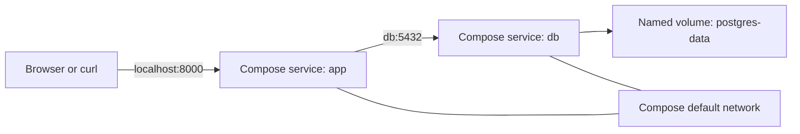
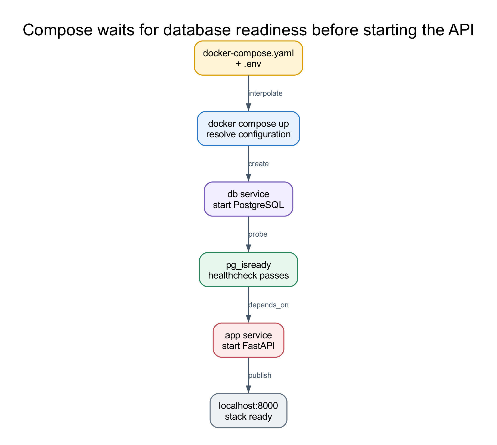

# Run the Stack With Docker Compose

[Docker Compose](https://docs.docker.com/compose/) describes a multi-container application in one YAML file. It replaces the repeated build, network, volume, environment, and startup commands from lesson 4 while preserving the same service boundaries.

## Compose Architecture



Compose automatically creates a project network. Service names become DNS hostnames on that network, so the API connects to `db`, not `localhost`.

Compose also prefixes volume names with the project name. Its `postgres-data` volume is separate from the unprefixed volume used in lessons 2 and 4, so the first Compose run starts with a new database. Later Compose runs reuse that database unless its volume is removed.

## The Compose File

[`docker-compose.yaml`](docker-compose.yaml) defines the complete stack:

```yaml
services:
  db:
    image: postgres:17
    environment:
      POSTGRES_USER: ${POSTGRES_USER}
      POSTGRES_PASSWORD: ${POSTGRES_PASSWORD}
      POSTGRES_DB: ${POSTGRES_DB}
    ports:
      - "5432:5432"
    volumes:
      - postgres-data:/var/lib/postgresql/data
    healthcheck:
      test: ["CMD-SHELL", "pg_isready -U ${POSTGRES_USER} -d ${POSTGRES_DB}"]
      interval: 5s
      timeout: 5s
      retries: 10

  app:
    build:
      context: .
      dockerfile: service/Dockerfile
    environment:
      DB_CONN: postgresql+psycopg://${POSTGRES_USER}:${POSTGRES_PASSWORD}@db:5432/${POSTGRES_DB}
    ports:
      - "8000:8000"
    healthcheck:
      test:
        - CMD
        - python
        - -c
        - import urllib.request; urllib.request.urlopen('http://localhost:8000/', timeout=2)
      interval: 5s
      timeout: 3s
      retries: 10
      start_period: 5s
    depends_on:
      db:
        condition: service_healthy

volumes:
  postgres-data:
```

## How to Read the Configuration

| Field | Role in this stack |
| --- | --- |
| `image` | Pull the official PostgreSQL image |
| `build` | Build the API using its Dockerfile and the root context |
| `environment` | Supply per-container configuration at runtime |
| `ports` | Publish service ports to the host |
| `volumes` | Persist PostgreSQL data independently of containers |
| `healthcheck` | Check database readiness and API HTTP availability |
| `depends_on` | Wait for database health before starting the API |

The `${...}` expressions are interpolated from the ignored root `.env` file. The resolved database URL uses `db` because that is the database service name inside the Compose network.

## Validate the Resolved Configuration

Create `.env` if needed, then ask Compose to render the final configuration:

```bash
cp .env.example .env
docker compose config
```

Inspect the output before starting services. This catches missing variables, invalid YAML, and path mistakes. The rendered output includes development credentials, so do not publish it as a build artifact or log it in a shared production system.

## Build and Start the Stack

```bash
docker compose up --build --wait
```

Compose now:

1. creates the project network and named volume,
2. starts PostgreSQL,
3. waits for the database healthcheck,
4. builds and starts the API,
5. waits for the API healthcheck,
6. publishes ports `5432` and `8000` to the host.



*Diagram based on Docker's official [Compose startup order](https://docs.docker.com/compose/how-tos/startup-order/) guidance.*

## Observe Runtime State

```bash
docker compose ps
docker compose logs db
docker compose logs app
docker compose logs -f
```

`docker compose ps` should show both the database and the API as healthy.

## Exercise the API

```bash
curl http://localhost:8000/

curl -X POST http://localhost:8000/users \
    -H "Content-Type: application/json" \
    -d '{"name":"Jane Doe","email":"jane.doe@example.com"}'

curl http://localhost:8000/users
```

The same Swagger UI remains available at <http://localhost:8000/docs>. Containerization changes deployment mechanics, not the API contract.

## Rebuild After Code Changes

The image contains a copy of `service/`, so source changes require a rebuild:

```bash
docker compose up --build --wait app
```

This repository intentionally avoids a development bind mount. The lesson demonstrates reproducible image builds rather than live-reload container development.

## Stop or Reset the Stack

Stop and remove containers and the project network while preserving database data:

```bash
docker compose down
```

Also delete the named database volume only when a complete reset is intended:

```bash
docker compose down --volumes
```

## Checkpoint

**What does the PostgreSQL healthcheck add beyond container startup order?**

**Answer:** A running PostgreSQL process may still be initializing and unable to accept queries. The healthcheck tests readiness, and the long-form `depends_on` condition delays the API until that readiness check succeeds.

## Summary

Docker Compose now expresses the same two-service architecture as versioned configuration. One command builds the locked API image, starts both services in dependency order, creates their private network, and attaches persistent database storage.
